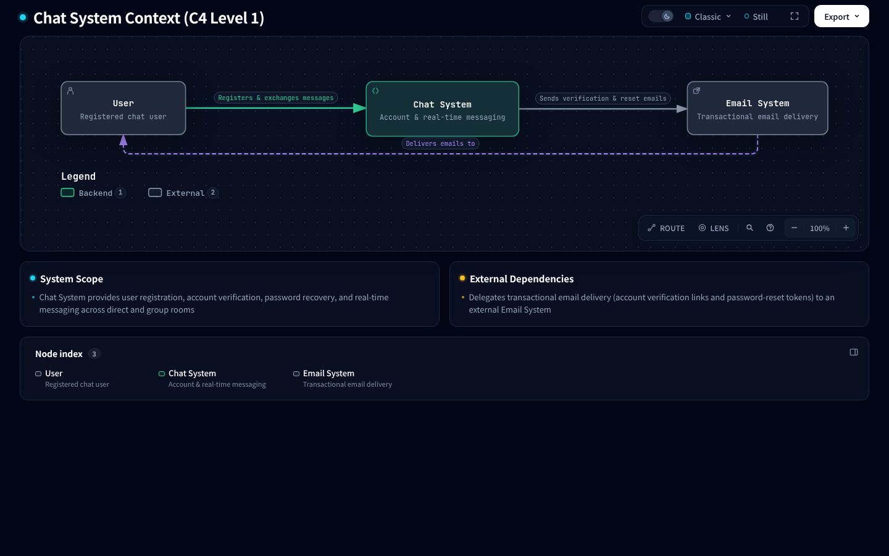
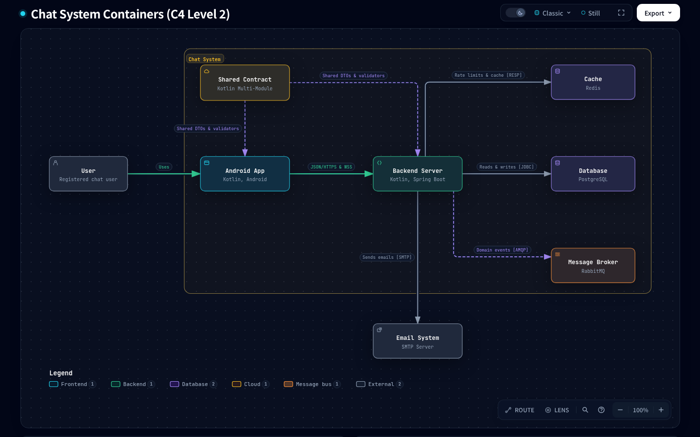

# KMP-ChatContract Blueprint

## System Overview

Pure-Kotlin multi-module contract repository containing shared wire DTOs, sealed endpoint error contracts, validation
rules, and WebSocket message models for the end-to-end chat project.

> **Architecture & Philosophy**
> - Read [docs/PHILOSOPHY.md](docs/PHILOSOPHY.md) for the architectural principles, decision filters, and AI agent
>     governance rules governing this project.
> - **Medium
>     Series**: [Part 1 — End-to-End Type Safety: Sharing Pure Kotlin Contracts Between Android and Spring Boot](https://medium.com/@neronguyen/end-to-end-type-safety-sharing-pure-kotlin-contracts-between-android-and-spring-boot-part-1-8c45e3ab6720)

### Related Repositories

| Repository | Role | C4 Architecture Level | Tech Stack |
|:---|:---|:---|:---|
| **[KMP-ChatContract](https://github.com/neronguyen/KMP-ChatContract)** *(this repo)* | Compile-time wire schema, error contracts, and shared validators | **Level 1** (System Context) & **Level 2** (Containers) | Pure Kotlin 2.4, `kotlinx.serialization` |
| **[KMP-ChatBackend](https://github.com/neronguyen/KMP-NeroChatBackend)** | Modular monolith REST & WebSocket server | **Level 3** (Backend Components) | Kotlin, Spring Boot 4, PostgreSQL, Redis (Redisson), RabbitMQ |
| **[Android-ChatApp](https://github.com/neronguyen/Android-NeroChatApp)** | Native Android client with offline-first persistence and real-time sync | **Level 3** (Android Components) | Jetpack Compose, Navigation 3, Retrofit, OkHttp, Room, DataStore, Hilt, Arrow |

### System Architecture (C4 Model)

> **Interactive Architecture Viewers**:
> - **Level 1 — System Context**: [`docs/architecture/interactive/c4-system-context.html`](docs/architecture/interactive/c4-system-context.html)
> - **Level 2 — Containers**: [`docs/architecture/interactive/c4-containers.html`](docs/architecture/interactive/c4-containers.html)

#### Level 1 — System Context

<picture>
  <source media="(prefers-color-scheme: dark)" srcset="docs/architecture/assets/SystemContext.png">
  <source media="(prefers-color-scheme: light)" srcset="docs/architecture/assets/SystemContext.light.png">
  
</picture>

#### Level 2 — Containers

<picture>
  <source media="(prefers-color-scheme: dark)" srcset="docs/architecture/assets/Containers.png">
  <source media="(prefers-color-scheme: light)" srcset="docs/architecture/assets/Containers.light.png">
  
</picture>

## Subdirectories & System Boundaries

- [contract](./contract/README.md) - Root blueprint for wire DTOs, sealed error hierarchies, and WebSocket frames.
  - [contract:common](./contract/common/README.md) - Shared error primitives (`ErrorCode`, `ServerError`, `ApiErrorDto`).
  - [contract:auth](./contract/auth/README.md) - Authentication wire DTOs and `AuthServerError` sealed contracts.
  - [contract:chat](./contract/chat/README.md) - Chat wire DTOs, polymorphic WebSocket frames, and `ChatServerError`.
- [validation](./validation/README.md) - Root blueprint for pure Kotlin validation libraries.
  - [validation:common](./validation/common/README.md) - Core validation primitives (`Validatable`, `ValidationError`, `EmailValidator`, `UuidValidator`).
  - [validation:auth](./validation/auth/README.md) - Authentication input validators (`AuthValidator`, `PasswordValidator`).
  - [validation:chat](./validation/chat/README.md) - Chat input validators (`ChatValidator`, `ChatValidationError`).
- [docs/architecture/flows](./docs/architecture/flows/README.md) - Master SSOT registry for cross-repository sequence and lifecycle flows.
- [docs/designs](./docs/designs/SITEMAP.md) - Design document index.

## Global Invariants

- **Zero Framework Leakage**: No Spring, Android, Jackson, Retrofit, or database dependencies. Pure Kotlin standard library + `kotlinx.serialization` only.
- **KMP Readiness**: Main sources must not call JVM-only standard library APIs (`java.lang.*`, `java.util.*`).
- **Flat `ErrorCode` Wire Format**: All `ServerError` singletons serialize as flat JSON strings (`"AuthServerError.InvalidCredentials"`), never nested objects.
- **Golden Snapshot Guardrails**: Every `ServerError` entry must be cataloged in its companion `ErrorContract` and verified against golden error-code files.
- **WebSocket Frame Discriminator**: Sealed hierarchies `WsClientMessage` and `WsServerEvent` must use `@JsonClassDiscriminator("type")`.

## Global Side Effects

- None (pure data contracts, serialization schemas, and in-memory validators; zero network, disk, or state mutations).

## System Verification

```bash
# Run all checks, golden snapshot tests, and reflection completeness tests
./gradlew check

# Run all unit tests across all 6 modules
./gradlew test --rerun-tasks

# Check binary compatibility baselines
./gradlew apiCheck
```
