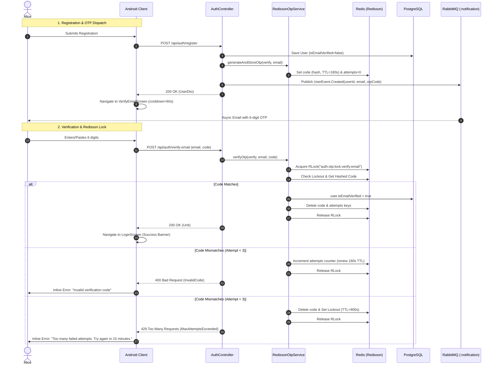

# 6-Digit OTP Email Verification & Password Reset Migration

* **Author:** Nero Nguyen
* **Status:** In Review
* **Date:** 2026-11-12
* **Target SSOT:** `KMP-ChatContract/docs/designs/otp-email-verification.md`

--------------------------------------------------------------------------------

## Overview

This technical design document specifies the complete migration of account email verification and password recovery
across `KMP-ChatContract`, `KMP-ChatBackend`, and `Android-ChatApp` from email deep links to an interactive 6-digit
numeric One-Time Password (OTP) flow.

All OTP persistence, attempt throttling, brute-force lockouts, and resend rate limits are implemented purely using
**Redisson** primitives (`RLock`, `RBucket`, `RAtomicLong`) without custom Redis Lua scripts, fully deprecating and
removing the relational `auth_tokens` table in PostgreSQL and intent filters in Android. The specification is anchored
in `KMP-ChatContract` as the cross-repository Single Source of Truth (SSOT), while the client experience adheres
strictly to the **Quiet Messaging** design system in `Android-ChatApp`.

--------------------------------------------------------------------------------

## The Problem

### 1. Fragile Client Deep Linking

Email deep links (`https://nerochat.com/api/auth/verify-email?token=...`) introduce unnecessary friction and failure
modes on mobile devices:

- Android 12+ requires domain verification (Digital Asset Links / `.well-known/assetlinks.json`). Verification failures
  or third-party email clients (Gmail, Outlook) often open links in external web browsers or Custom Tabs rather than the
  native app, stranding authentication state.
- Passing sensitive tokens in URL query strings risks token leakage in browser history, HTTP referer headers, proxy
  server access logs, and intent-redirection interception attacks.

### 2. High Architectural Churn in Existing Prototype

The previous relational implementation (`feat/change-verify-mail-to-6-digit-otp`) suffered from architectural defects:

- Ephemeral tokens (valid for 3–10 minutes) were written to the persistent PostgreSQL `auth_tokens` table, generating
  continuous database write I/O and index bloat, and requiring a daily scheduled cronjob (`TokenPurgeService`) to delete
  expired rows.
- Transaction rollback bug: In `EmailVerificationService.verifyEmail`, throwing domain runtime exceptions
  (`InvalidTokenException`, `MaxAttemptsExceededException`) under Spring's default `@Transactional` caused attempt
  increment updates (`attempts += 1`) to be rolled back in PostgreSQL, allowing attackers to bypass the 5-attempt limit.
- Missing IP rate limiting on `POST /api/auth/verify-email`, leaving verification endpoints open to distributed
  enumeration.

### Proposed Solution

Replace deep links with a self-contained in-app 6-digit numeric OTP workflow. Manage ephemeral lifecycle, attempt
tracking, and distributed rate limits purely in Redis via Redisson primitives, completely eliminating relational
database tables and background cleanup jobs.

--------------------------------------------------------------------------------

## Goals

* **G1 (Unified OTP Scope):** Replace deep links with 6-digit numeric OTPs across both:
    1. Account Email Verification (`POST /api/auth/verify-email`, `POST /api/auth/resend-verification`).
    2. Password Reset (`POST /api/auth/forgot-password`, `POST /api/auth/reset-password`).
* **G2 (Pure Redisson Storage & Concurrency):** Manage all OTP codes, attempt counters, and lockout state in Redis using
  Redisson typed Kotlin primitives (`RLock`, `RBucket`, `RAtomicLong`) with zero custom Lua scripts. Completely drop the
  `auth_tokens` PostgreSQL table.
* **G3 (Hardened Brute-Force & Abuse Defense):**
    - Enforce a strict **3-minute (180s)** validity window per generated OTP.
    - Enforce a hard ceiling of **3 failed attempts** per OTP. On the 3rd failed attempt, invalidate the OTP immediately
      and trigger a **15-minute (900s)** lockout on that email.
    - Enforce exponential resend cooldown (`60s` → `300s` → `3600s`) via `EmailRateLimitingService`.
    - Enforce distributed IP rate limiting via `@IpRateLimiting` on all verification and reset endpoints.
    - Store salted SHA-256 hashes of OTP codes in Redis with application pepper to protect server logs and memory dumps.
* **G4 (Anti-Enumeration Invariant):** Ensure `POST /api/auth/resend-verification` and `POST /api/auth/forgot-password`
  return uniform `204 No Content` under all circumstances (including active lockout and non-existent users) without
  leaking whether an email address exists in the system.
* **G5 (Token Revocation on Password Reset):** Atomically revoke all active refresh tokens in `RefreshTokenRepository`
  when a password reset succeeds, forcing re-authentication across all active client devices.
* **G6 (Quiet Messaging UI & Lifecycle Survivability):** Build a 6-cell segmented OTP input component in
  `Android-ChatApp` matching MCP Stitch *Quiet Messaging* design tokens. Persist cooldown target timestamps in
  `SavedStateHandle` to survive configuration changes and process death, with zero silent network retries.
* **G7 (Cross-Repo SSOT Governance):** Maintain the master EGM design specification in
  `KMP-ChatContract/docs/designs/otp-email-verification.md` and sequence diagram in
  `flows/otp-verification.sequence.archify.json`.

--------------------------------------------------------------------------------

## Non-Goals

* **NG1 (SMS / Phone Auth):** Out of scope. Verification is strictly email-based.
* **NG2 (Deep Link Backward Compatibility):** No dual-support or transitional fallback for email deep links. Old
  verification URLs and intent filters are completely removed.
* **NG3 (Legacy Data Migration):** In-flight unverified users or expired tokens in PostgreSQL are discarded.
* **NG4 (Custom Redis Lua Scripts):** All Redis operations use typed Kotlin Redisson primitives.
* **NG5 (Biometric Auth during Password Reset):** Biometrics are not involved in password recovery.

--------------------------------------------------------------------------------

## Open Questions

* *(All primary architectural contradictions were resolved during the EGM Brainstorm & Multi-Lens Review phases:
  Redisson chosen over PostgreSQL; 3-min TTL + 3 attempts + 15-min lockout selected; password oracle prevented via
  post-OTP equality checks; Arrow Either types adopted; master spec anchored in KMP-ChatContract).*

--------------------------------------------------------------------------------

## Critical User Journeys (CUJs)

### CUJ 1: New User Account Registration & In-App Email Verification

* **Given**: An unregistered user with email `alice@example.com` and password `Password123!`.
* **When**:
    1. Alice submits registration in `RegisterScreen`.
    2. Backend creates unverified user in PostgreSQL, generates a zero-padded 6-digit OTP
       (`String.format("%06d", ...)`), stores its salted SHA-256 hash in Redis with 180s TTL, and dispatches
       `UserEvent.Created` via RabbitMQ.
    3. Android navigates to `VerifyEmailScreen` displaying Alice's email, a 6-box segmented OTP field, and a 60-second
       resend cooldown timer.
    4. Alice receives the email, copies the 6-digit code, pastes it into the OTP field (auto-filling all 6 cells), and
       the screen automatically submits `POST /api/auth/verify-email`.
* **Then**:
    1. Backend acquires Redisson lock, verifies hashed code, deletes Redis keys, and marks `isEmailVerified = true` in
       PostgreSQL.
    2. Backend returns `200 OK` (HTTP 200 with empty body / `Unit`).
    3. Android navigates Alice to `LoginScreen` with email pre-filled and an inline confirmation banner: *"Email
       verified successfully. Please log in."*

### CUJ 2: Brute-Force Defense & 15-Minute Lockout

* **Given**: An attacker attempts to guess Alice's 6-digit email verification OTP.
* **When**:
    1. Attacker sends 3 consecutive incorrect codes to `POST /api/auth/verify-email`.
* **Then**:
    1. The 1st and 2nd incorrect attempts increment the Redisson attempt counter (with 180s TTL renewal) and return
       `400 Bad Request` with `AuthServerError.InvalidCode`.
    2. The 3rd incorrect attempt immediately deletes the OTP code key, resets the attempt counter, sets
       `auth:otp:lockout:verify:alice@example.com` (`RBucket<Boolean>` = `true`) with 15-minute (900s) TTL, and returns
       `429 Too Many Requests` with `AuthServerError.MaxAttemptsExceeded`.
    3. Any subsequent verification attempt within 15 minutes returns `429 Too Many Requests`.
    4. Any resend verification attempt (`POST /api/auth/resend-verification`) within 15 minutes silently returns
       `204 No Content` to preserve the anti-enumeration invariant.

### CUJ 3: Forgot Password Recovery & Global Session Revocation (Anti-Oracle Protection)

* **Given**: A registered user Bob forgets his password and has an active login session on a tablet.
* **When**:
    1. Bob enters his email on `ForgotPasswordScreen` and submits.
    2. Backend returns `204 No Content` and queues reset OTP email via RabbitMQ (`UserEvent.RequestResetPassword`).
    3. Bob enters the 6-digit OTP, new password `NewSecretPassword456!`, and confirms it on `ResetPasswordScreen`.
    4. Android validates matching passwords client-side and submits `POST /api/auth/reset-password`.
* **Then**:
    1. Backend performs stateless format checks (`PasswordValidator.isValidPassword`) *before* touching Redis.
    2. Backend acquires Redisson lock and verifies the OTP code. (If the code is invalid, it returns
       `AuthServerError.InvalidCode` without leaking whether the password matched the previous password, eliminating the
       Password Oracle vulnerability).
    3. Only after the OTP is verified, backend checks `passwordEncoder.matches(newPassword, user.hashedPassword)`. If
       equal, it throws `SamePasswordException` (`AuthServerError.SamePassword`).
    4. Backend updates password hash in PostgreSQL, deletes Redis OTP keys, and executes
       `refreshTokenRepository.deleteByUserId(bob.id)`.
    5. Bob's tablet session is invalidated upon its next refresh token rotation attempt.
    6. Bob's phone navigates to `LoginScreen` with a confirmation banner.

--------------------------------------------------------------------------------

## Technical Plan (Architecture)

### 1. Cross-Repository Topology & Architectural Boundaries

```text
┌────────────────────────────────────────────────────────────────────────┐
│                   KMP-ChatContract (Pure Kotlin SSOT)                  │
│  - VerifyEmailRequest(email, code) & ResetPasswordRequest(email, ...)   │
│  - AuthValidator (validateVerifyEmail, validateResetPassword)          │
│  - AuthServerError: InvalidCode, CodeExpired, MaxAttemptsExceeded,     │
│    AccountAlreadyVerified                                              │
│  - Golden Snapshots: auth-error-codes-golden.txt                       │
└──────────────────────────────────┬─────────────────────────────────────┘
                                   │ Wire DTOs & Error Hierarchy
          ┌────────────────────────┴────────────────────────┐
          ▼                                                 ▼
┌───────────────────────────────────┐     ┌──────────────────────────────────┐
│     KMP-ChatBackend (Server)      │     │     Android-ChatApp (Client)     │
│  - RedissonOtpService (Pure Redis)│     │  - OtpInputField (:core:ui)     │
│  - Redisson: RLock, RBucket,      │     │  - VerifyEmailScreen             │
│    RAtomicLong                    │     │  - ResetPasswordScreen           │
│  - RabbitMQ: UserEvent dispatch   │     │  - SavedStateHandle Epoch Timers │
│  - Drop: auth_tokens DB table     │     │  - Quiet Messaging Theme Tokens  │
│  - Drop: TokenPurgeService cron   │     │  - Arrow Either<E, A> in Data    │
└───────────────────────────────────┘     └──────────────────────────────────┘
```

### 2. Redis Keyspace Hierarchy & TTL Architecture

All OTP operational state is isolated from the relational database and organized in Redis via Redisson typed clients:

| Key Format                         | Redisson Type      | Payload / Value                    | TTL                      | Eviction Policy                                                                       |
|:-----------------------------------|:-------------------|:-----------------------------------|:-------------------------|:--------------------------------------------------------------------------------------|
| `auth:otp:code:{type}:{email}`     | `RBucket<String>`  | Salted SHA-256 hash of 6-digit OTP | `180s` (3 min)           | Hard expiry on TTL or deleted upon verification / lockout                             |
| `auth:otp:attempts:{type}:{email}` | `RAtomicLong`      | Failed attempt count (`0..3`)      | `180s` (3 min)           | Explicitly renewed on increment (`expire(180s)`); deleted upon verification / lockout |
| `auth:otp:lockout:{type}:{email}`  | `RBucket<Boolean>` | `true`                             | `900s` (15 min)          | Automatic expiration; presence blocks verification and resend                         |
| `auth:otp:lock:{type}:{email}`     | `RLock`            | Distributed lock lease (`2s`)      | Auto-released            | Guards concurrent check-and-increment operations against race conditions              |
| `rate_limit:email:{email}`         | `RBucket<String>`  | Resend backoff flag (`1`)          | `60s` / `300s` / `3600s` | Controlled by existing `EmailRateLimitingService`                                     |
| `attempt_count:email:{email}`      | `RAtomicLong`      | Total resends in 24h window        | `24 hours`               | Controlled by existing `EmailRateLimitingService`                                     |

*Note: `{type}` is strictly partitioned as `verify` (registration verification) or `reset` (password recovery) to
prevent cross-flow token collisions.*

### 3. Concurrency, Race Condition Prevention & Verification Algorithm

To prevent concurrent brute-force race conditions where parallel HTTP requests attempt to bypass the 3-attempt ceiling:

1. `RedissonOtpService.verifyOtp` acquires `RLock("auth:otp:lock:$type:$email")` with a 2-second lease time.
2. If `auth:otp:lockout:$type:$email` exists, immediately return `AuthServerError.MaxAttemptsExceeded` (HTTP 429).
3. If `auth:otp:code:$type:$email` does not exist:
    - Query `userRepository.findByEmail(email)`. If `type == verify` and `user?.isEmailVerified == true`, return
      `AuthServerError.AccountAlreadyVerified` (HTTP 400).
    - Otherwise, return `AuthServerError.CodeExpired` (HTTP 400).
4. Hash the incoming code with application pepper and email salt (`sha256Hex("$email:$rawCode:$pepper")`) and perform a
   constant-time comparison against the stored hash (`MessageDigest.isEqual`).
5. **On Success**:
    - For `verify`: execute PostgreSQL update `user.isEmailVerified = true`.
    - For `reset`: execute semantic check `passwordEncoder.matches(newPassword, user.hashedPassword)` (throwing
      `SamePasswordException` if true). Then update password hash and call
      `refreshTokenRepository.deleteByUserId(user.id)`.
    - Atomically delete `auth:otp:code:...` and `auth:otp:attempts:...`.
6. **On Mismatch**:
    - Increment `RAtomicLong("auth:otp:attempts:$type:$email")` and call `.expire(Duration.ofSeconds(180))`.
    - If the new attempt count $\ge 3$:
        - Delete `auth:otp:code:...` and `auth:otp:attempts:...`.
        - Set `auth:otp:lockout:$type:$email` (`RBucket<Boolean>` = `true`) with 15-minute (900s) TTL.
        - Return `AuthServerError.MaxAttemptsExceeded` (HTTP 429).
    - If the count $< 3$:
        - Return `AuthServerError.InvalidCode` (HTTP 400) indicating incorrect code.



### 4. Client-Side Presentation & Lifecycle Architecture

#### 4.1 Segmented `OtpInputField` Component

- Located in `:core:ui` under `io.github.neronguyen.chat.core.ui.component.OtpInputField`.
- Geometry: 6 discrete square cells (`48.dp` x `56.dp`) styled with Quiet Messaging tokens (`ChatSurface`, `ChatBorder`,
  `ChatPrimary`).
- Focus & Keyboard: A single underlying transparent `BasicTextField` managing the `0..6` character string with
  `KeyboardType.Number` (disabling predictive dictionary and password manager auto-fill overlays), rendering 6 visual
  box projections with animated cursor indicators.
- Auto-Advance & Rewind: Cursor position dynamically projects from the single string's length; backspace naturally
  deletes the trailing character.
- Clipboard Paste: Inspects pasted text, sanitizes non-numeric characters (`filter { it.isDigit() }.take(6)`), and
  updates the string instantly.
- Accessibility: Single merged semantic node announcing current code length to TalkBack (e.g., "Verification code, 4 of
  6 digits entered").

#### 4.2 Declarative Epoch Cooldown (`SavedStateHandle`)

- To prevent countdown timers from freezing, resetting to 60s, or disappearing upon device rotation or OS process
  recreation, `VerifyEmailViewModel` and `ResetPasswordViewModel` store:
  ```kotlin
  val cooldownEndEpochMs: Long = savedStateHandle["cooldown_end_epoch"] ?: 0L
  ```
- The remaining seconds displayed in the UI is computed as a declarative projection against wall-clock time:
  ```kotlin
  val remainingSeconds = max(0L, (cooldownEndEpochMs - System.currentTimeMillis()) / 1000L)
  ```
- Distinct Screen Submission Behaviors:
    - `VerifyEmailScreen`: Automatically triggers verify when the 6th digit is entered.
    - `ResetPasswordScreen`: Does **not** auto-submit on the 6th digit. Enables the primary "Reset Password" CTA button
      only when OTP (6 digits), new password, and password confirmation all satisfy validation.
- Network failure error boundary: If `POST /api/auth/verify-email` fails due to network disconnection (`IOException`),
  the UI transitions to an inline error state with a manual retry button. It **never** issues background automated
  retries to avoid wasting attempt counters.

--------------------------------------------------------------------------------

## Non-Functional Requirements

### Security & Privacy

* **At-Rest Hash Protection**: OTP codes are salted and hashed with SHA-256 and application pepper before being stored
  in Redis, ensuring memory dumps and Redis commands monitors never reveal plaintext 6-digit codes.
* **Timing Attack Mitigation**: Hash comparisons use constant-time byte comparison (`MessageDigest.isEqual`).
* **Anti-Enumeration Uniformity**: Both `POST /api/auth/resend-verification` and `POST /api/auth/forgot-password` return
  `204 No Content` under all conditions, even when an account is locked out or does not exist.
* **Password Oracle Immunity**: Password equality against history (`SamePassword`) is executed strictly after OTP
  verification.

### Performance & Scalability

* **Zero Database I/O for Ephemeral Tokens**: Database transactions in PostgreSQL occur only upon successful
  verification or registration, eliminating database write bloat.
* **Sub-10ms Redis Latency**: Redisson in-memory operations execute well within SLA boundaries, backed by connection
  pooling.
* **Decoupled Email Dispatch**: Email delivery occurs asynchronously via RabbitMQ `:notification` consumers, preventing
  SMTP latency from blocking HTTP threads.

### Rollout & Migration

* **Clean Breaking Migration**: No backward-compatible deep links.
* **Database Schema Cleanup**: The PostgreSQL table `auth_tokens` and `TokenPurgeService` cronjob are completely
  deleted.

--------------------------------------------------------------------------------

## Alternatives Considered

### Alternative 1: Ephemeral OTP Storage in PostgreSQL with `noRollbackFor` (Option B)

* **Pros**:
    * Preserves the existing `auth_tokens` table structure from the prototype branch
      (`feat/change-verify-mail-to-6-digit-otp`).
    * Reuses ~90% of existing service and repository unit test fixtures.
    * Maintains ACID durability across user updates and token status within a single relational database engine.
* **Cons**:
    * High write I/O and continuous index churn for 3-minute ephemeral tokens.
    * Requires maintaining a scheduled daily vacuum/purge cronjob (`TokenPurgeService`).
    * Plaintext tokens or salt hashes persist in database snapshots and transaction logs.
* **Reason for Rejection**: *Rejected by author: Ephemeral 3-minute tokens should not pollute persistent relational
  storage or require daily background purge jobs. Managing OTP state purely in Redis via Redisson primitives eliminates
  database write bloat, natively guarantees automated TTL expiry, and removes transaction rollback hazards.*

### Alternative 2: Custom Redis Lua Scripts for Atomic Verification

* **Pros**:
    * Executes check, comparison, attempt counting, and deletion in a single atomic transaction inside the Redis server
      process.
* **Cons**:
    * Embedded Lua scripts inside Kotlin multiline strings are opaque, brittle, difficult to refactor, and challenging
      to unit test.
    * Diverges from the rest of `KMP-ChatBackend`, which standardizes on typed Redisson Kotlin abstractions (`RLock`,
      `RBucket`, `RAtomicLong` in `EmailRateLimitingService` and `IpRateLimitingService`).
* **Reason for Rejection**: *Rejected by author: Maintaining custom raw Lua scripts increases cognitive overhead and
  maintenance debt. Using typed Redisson primitives (`RLock` + `RBucket` + `RAtomicLong`) provides identical concurrency
  guarantees while preserving clean, testable Kotlin source code.*

### Alternative 3: 10-Minute TTL with 5 Attempts (Relaxed Prototype Model)

* **Pros**:
    * Provides maximum time allowance for users experiencing email network delays.
* **Cons**:
    * A 10-minute window combined with 5 attempts is too permissive for a small $10^6$ keyspace, leaving the system
      vulnerable to distributed brute-force enumeration.
* **Reason for Rejection**: *Rejected by author: 10 minutes creates an unnecessarily large vulnerability window.
  Shortening TTL to 3 minutes and capping failed attempts at 3 with an immediate 15-minute lockout provides robust
  brute-force defense, while asynchronous RabbitMQ email delivery and invalidate-on-resend handle legitimate delivery
  latency.*

### Alternative 4: Retaining Deep Links with Fallback to OTP

* **Pros**:
    * Provides backward compatibility if existing users click old email links.
* **Cons**:
    * Retains dual attack surfaces (token leaks in browser histories vs OTP enumeration).
    * Forces `Android-ChatApp` to maintain complex Android 12+ App Links auto-verify domain configurations in
      `AndroidManifest.xml`.
    * Requires dual endpoints and routing logic in `KMP-ChatBackend`.
* **Reason for Rejection**: *Rejected by author: A clean-cut breaking migration simplifies both client and backend
  codebases. Unverified legacy token data is discarded.*

### Alternative 5: 4-Digit or 8-Digit OTPs

* **Pros**:
    * 4 digits: Faster entry on mobile.
    * 8 digits: Massive keyspace ($10^8$).
* **Cons**:
    * 4 digits: Keyspace of $10^4$ is dangerously small and susceptible to rapid brute-force.
    * 8 digits: High cognitive friction for mobile users memorizing and re-typing codes from email notifications.
* **Reason for Rejection**: *Rejected by author: 6 digits ($10^6$) represents the industry-standard balance between
  usability and cryptographic entropy when paired with attempt caps and lockouts.*

--------------------------------------------------------------------------------

## Detailed Implementation Plan

The implementation is executed in three strictly sequenced phases following the dependency graph
(`KMP-ChatContract` $\to$ `KMP-ChatBackend` $\to$ `Android-ChatApp`).

```text
┌────────────────────────────────┐
│   Phase 1: KMP-ChatContract    │  Wire DTOs, Validation, Error Codes, Golden Snapshots
└────────────────┬───────────────┘
                 │ (Publishes or local Gradle reference)
                 ▼
┌────────────────────────────────┐
│    Phase 2: KMP-ChatBackend    │  RedissonOtpService, Controller Refactor, DB Cleanup, Events
└────────────────┬───────────────┘
                 │ (Exposes OpenAPI / Mock endpoints)
                 ▼
┌────────────────────────────────┐
│    Phase 3: Android-ChatApp    │  OtpInputField, Screens, SavedStateHandle, Arrow Either
└────────────────────────────────┘
```

### Phase 1: `KMP-ChatContract` (Wire DTOs & Error Hierarchy)

#### 1. `contract/auth/src/main/kotlin/io/github/neronguyenvn/nerochat/contract/auth/VerifyEmailRequest.kt` (Create)

* **Type / Scope**: Kotlin Wire DTO (`contract:auth`).
* **Proposed Changes**: Define
  `@Serializable data class VerifyEmailRequest(val email: String, val code: String) : Validatable<AuthValidationError.VerifyEmail>`.
  Implement validation ensuring email is valid and `code` satisfies `validateOtpCode`. Redact sensitive fields in
  `toString()`.

#### 2. `contract/auth/src/main/kotlin/io/github/neronguyenvn/nerochat/contract/auth/ResetPasswordRequest.kt` (Modify)

* **Type / Scope**: Kotlin Wire DTO (`contract:auth`).
* **Proposed Changes**: Update fields to `(val email: String, val code: String, val newPassword: String)`. Add
  validation for `email`, `code` (`validateOtpCode`), and `newPassword`. Redact `newPassword` and `code` in
  `toString()`.

#### 3. `validation/auth/src/main/kotlin/io/github/neronguyenvn/nerochat/contract/validation/auth/AuthValidator.kt` (Modify)

* **Type / Scope**: Pure Kotlin Validation Library (`validation:auth`).
* **Proposed Changes**: Add `fun validateOtpCode(code: String): AuthValidationError?` enforcing exactly 6 ASCII digits
  (`code.length == 6 && code.all { it in '0'..'9' }`). Add
  `fun validateVerifyEmail(email: String, code: String): List<AuthValidationError.VerifyEmail>` and update
  `validateResetPassword`.

#### 4. `validation/auth/src/main/kotlin/io/github/neronguyenvn/nerochat/contract/validation/auth/AuthValidationError.kt` (Modify)

* **Type / Scope**: Sealed ValidationError hierarchy (`validation:auth`).
* **Proposed Changes**: Define sub-interface `sealed interface VerifyEmail : AuthValidationError`. Add sealed subclasses
  `EmptyOtpCode`, `InvalidOtpLength`, and `NonNumericOtp` implementing both `VerifyEmail` and `ResetPassword`. Update
  `ResetPassword` to incorporate `EmptyEmail` and `InvalidEmail`.

#### 5. `contract/auth/src/main/kotlin/io/github/neronguyenvn/nerochat/contract/auth/error/AuthServerError.kt` (Modify)

* **Type / Scope**: Sealed ServerError hierarchy (`contract:auth`).
* **Proposed Changes**:
    - Under `sealed interface VerifyEmail : AuthServerError`: Add `data object InvalidCode`, `data object CodeExpired`,
      `data object MaxAttemptsExceeded`, `data object AccountAlreadyVerified`. Register in companion
      `ErrorContract<VerifyEmail>`.
    - Under `sealed interface ResetPassword : AuthServerError`: Add `data object InvalidCode`,
      `data object CodeExpired`, `data object MaxAttemptsExceeded`. Register in companion
      `ErrorContract<ResetPassword>`.

#### 6. `contract/auth/src/test/resources/auth-error-codes-golden.txt` & `contract/chat/src/test/resources/error-codes-golden.txt` (Modify)

* **Type / Scope**: Golden error code snapshots.
* **Proposed Changes**: Append the new error codes to pass binary compatibility and completeness assertions
  (`apiCheck`).

#### 7. `docs/architecture/specifications/flows/otp-verification.sequence.archify.json` (Create)

* **Type / Scope**: Archify Sequence Diagram Specification (`docs/architecture/`).
* **Proposed Changes**: Define the end-to-end `[PLANNED]` sequence spec for OTP registration and password recovery.

#### 8. Module Contracts (`contract/auth/README.md`, `validation/auth/README.md`, `docs/README.md`) (Modify)

* **Type / Scope**: Module boundary contracts and unified documentation index.
* **Proposed Changes**: Document new DTOs, validator functions, and register `otp-verification.sequence.archify.json`
  and this design document.

---

### Phase 2: `KMP-ChatBackend` (Redisson OTP Services, Events & Database Purge)

#### 9. `common/src/main/kotlin/io/github/neronguyenvn/nerochat/domain/event/UserEvent.kt` (Modify)

* **Type / Scope**: Cross-cutting AMQP Domain Event (`:common`).
* **Proposed Changes**: In `UserEvent.Created` and `UserEvent.RequestResendVerification`, replace
  `verificationToken: String` with `otpCode: String`. In `UserEvent.RequestResetPassword`, replace
  `passwordResetToken: String` with `otpCode: String`.

#### 10. `user/src/main/kotlin/io/github/neronguyenvn/nerochat/user/service/RedissonOtpService.kt` (Create)

* **Type / Scope**: Spring Service (`:user`).
* **Proposed Changes**: Implement zero-padded OTP generation
  (`String.format("%06d", SecureRandom().nextInt(1_000_000))`), peppered SHA-256 hashing, storage in `RBucket<String>`
  with 180s TTL, attempt counting via `RAtomicLong` with explicit 180s renewal, lockout via `RBucket<Boolean>` (`true`)
  with 900s TTL, and concurrency protection via `RLock`.

#### 11. `user/src/main/kotlin/io/github/neronguyenvn/nerochat/user/service/EmailVerificationService.kt` (Modify)

* **Type / Scope**: Spring Service (`:user`).
* **Proposed Changes**: Drop dependency on `AuthTokenRepository`. Integrate `RedissonOtpService`. When `verifyEmail`
  succeeds, set `user.isEmailVerified = true` in `UserRepository` and publish `UserEvent.Verified`.

#### 12. `user/src/main/kotlin/io/github/neronguyenvn/nerochat/user/service/PasswordResetService.kt` (Modify)

* **Type / Scope**: Spring Service (`:user`).
* **Proposed Changes**: Drop dependency on `AuthTokenRepository`. In `resetPassword`, perform stateless password
  validation first, verify OTP in Redis, then execute semantic `SamePasswordException` check. Upon success, update
  password hash, delete all refresh tokens via `refreshTokenRepository.deleteByUserId`, and delete Redis OTP keys.

#### 13. `user/src/main/kotlin/io/github/neronguyenvn/nerochat/user/api/controller/AuthController.kt` (Modify)

* **Type / Scope**: Spring RestController (`:user`).
* **Proposed Changes**:
    - Change `verifyEmail` from `GET /verify-email?token=...` to `POST /verify-email` accepting
      `@Valid @RequestBody body: VerifyEmailRequest`. Add `@IpRateLimiting`.
    - Change `resetPassword` to accept `@Valid @RequestBody body: ResetPasswordRequest`.
    - Preserve anti-enumeration on `resendVerification` and `forgotPassword` returning `204 No Content` uniformly (even
      during active lockout).

#### 14. `user/src/main/kotlin/io/github/neronguyenvn/nerochat/user/api/advice/AuthExceptionHandler.kt` (Modify)

* **Type / Scope**: Controller Advice (`:user`).
* **Proposed Changes**: Add handlers for `OtpExpiredException` (maps to `AuthServerError.CodeExpired`, HTTP 400),
  `MaxAttemptsExceededException` (maps to `AuthServerError.MaxAttemptsExceeded`, HTTP 429),
  `AccountAlreadyVerifiedException` (maps to `AuthServerError.AccountAlreadyVerified`, HTTP 400), and
  `InvalidTokenException` (maps to `AuthServerError.InvalidCode`, HTTP 400).

#### 15. `user/src/main/kotlin/io/github/neronguyenvn/nerochat/user/infra/database/model/AuthTokenEntity.kt` & `repository/AuthTokenRepository.kt` (Delete)

* **Type / Scope**: Relational JPA Entity and Repository (`:user`).
* **Proposed Changes**: Delete files completely. Drop `auth_tokens` table via database migration script.

#### 16. `user/src/main/kotlin/io/github/neronguyenvn/nerochat/user/service/job/TokenPurgeService.kt` (Delete)

* **Type / Scope**: Scheduled Cron Job (`:user`).
* **Proposed Changes**: Delete the file and unschedule daily 03:00 ICT execution.

#### 17. `notification/src/main/kotlin/io/github/neronguyenvn/nerochat/notification/listener/NotificationUserEventListener.kt` & `service/EmailService.kt` (Modify)

* **Type / Scope**: RabbitMQ Listener & Email Delivery Service (`:notification`).
* **Proposed Changes**: Pass `event.otpCode` directly into template variable maps. In `EmailService`, remove URL
  encoding and deep link URL creation.

#### 18. `notification/src/main/resources/templates/emails/account-verification.html` & `reset-password.html` (Modify)

* **Type / Scope**: Thymeleaf Email Templates (`:notification`).
* **Proposed Changes**: Replace button deep links with a high-contrast, responsive 6-digit numeric OTP callout box with
  copy affordance and clear 3-minute validity disclaimer.

#### 19. Module Contracts & API Specs (`user/README.md`, `docs/openapi.json`, `docs/README.md`) (Modify)

* **Type / Scope**: Documentation and OpenAPI specifications.
* **Proposed Changes**: Update module contracts, regenerate OpenAPI 3.0 schema and Postman collection, and catalog the
  master design link in `docs/README.md`.

---

### Phase 3: `Android-ChatApp` (UI, ViewModels & Arrow Either Data Layer)

#### 20. `core/ui/src/main/kotlin/io/github/neronguyen/chat/core/ui/component/OtpInputField.kt` (Create)

* **Type / Scope**: Shared Jetpack Compose Component (`:core:ui`).
* **Proposed Changes**: 6 discrete cells (`48.dp` x `56.dp`) using Quiet Messaging tokens (`ChatSurface`, `ChatBorder`,
  `ChatPrimary`). Transparent `BasicTextField` with `KeyboardType.Number` (password manager autofill disabled), driving
  6 cell representations with animated cursor indicators. Include `@Preview` functions for empty, partial, full, and
  error states.

#### 21. `core/model/src/main/kotlin/io/github/neronguyen/chat/core/model/error/AuthError.kt` (Modify)

* **Type / Scope**: Domain Error Hierarchy (`:core:model`).
* **Proposed Changes**: Under sealed hierarchies `AuthError.VerifyEmail` and `AuthError.ResetPassword`, add
  `InvalidCode`, `CodeExpired`, `MaxAttemptsExceeded`, `AccountAlreadyVerified`.

#### 22. `core/data/src/main/kotlin/io/github/neronguyen/chat/core/data/mapper/AuthErrorMapper.kt` (Modify)

* **Type / Scope**: Data Layer Mapper (`:core:data`).
* **Proposed Changes**: Map contract `AuthServerError.InvalidCode`, `CodeExpired`, `MaxAttemptsExceeded`,
  `AccountAlreadyVerified` to domain `AuthError` equivalents.

#### 23. `core/network/src/main/kotlin/io/github/neronguyen/chat/core/network/retrofit/RetrofitAuthNetwork.kt` & `AuthNetworkDataSource.kt` (Modify)

* **Type / Scope**: Network Layer (`:core:network`).
* **Proposed Changes**: Update Retrofit signatures:
    - `@POST("api/auth/verify-email") suspend fun verifyEmail(@Body request: VerifyEmailRequest): Unit`
    - `@POST("api/auth/reset-password") suspend fun resetPassword(@Body request: ResetPasswordRequest): Unit`

#### 24. `core/data/src/main/kotlin/io/github/neronguyen/chat/core/data/repository/AuthRepository.kt` & `AuthRepositoryImpl.kt` (Modify)

* **Type / Scope**: Data Repository (`:core:data`).
* **Proposed Changes**: Add Arrow `Either` signatures:
  ```kotlin
  suspend fun verifyEmail(email: String, code: String): Either<AuthError.VerifyEmail, Unit>
  suspend fun resetPassword(email: String, code: String, newPassword: String): Either<AuthError.ResetPassword, Unit>
  suspend fun resendVerification(email: String): Either<AuthError.ResendVerification, Unit>
  suspend fun forgotPassword(email: String): Either<AuthError.ForgotPassword, Unit>
  ```
  Guard with offline network checks without auto-retry.

#### 25. `feature/auth/src/main/kotlin/io/github/neronguyen/chat/feature/auth/presentation/verify/VerifyEmailScreen.kt`, `VerifyEmailViewModel.kt`, `VerifyEmailUiState.kt` (Create/Salvage)

* **Type / Scope**: Feature UI & ViewModel (`:feature:auth`).
* **Proposed Changes**: Build Compose screen with `OtpInputField`, email display, inline banner feedback, and a
  declarative cooldown timer backed by `savedStateHandle["cooldown_end_epoch"]`. Automatically trigger verify when 6th
  digit is entered. Upon success, navigate to `LoginScreen` with email and success banner.

#### 26. `feature/auth/src/main/kotlin/io/github/neronguyen/chat/feature/auth/presentation/forgot/` & `reset/` (Create/Salvage)

* **Type / Scope**: Feature UI & ViewModels (`:feature:auth`).
* **Proposed Changes**: Build `ForgotPasswordScreen` (email input $\to$ trigger reset OTP) and `ResetPasswordScreen`
  (OTP input + new password + confirm new password + `SavedStateHandle` timer). Enable submit CTA only when all fields
  validate.

#### 27. `feature/auth/src/main/kotlin/io/github/neronguyen/chat/feature/auth/presentation/navigation/AuthNavigation.kt` & `AuthRoute.kt` (Modify)

* **Type / Scope**: Navigation 3 / Compose Navigation (`:feature:auth`).
* **Proposed Changes**: Add routes for `VerifyEmailRoute(val email: String)` and
  `ResetPasswordRoute(val email: String)`. Wire navigation transitions from `RegisterScreen` and `LoginScreen`.

#### 28. `app/src/main/AndroidManifest.xml` & `MainActivity.kt` (Verify)

* **Type / Scope**: Android Application Configuration (`:app`).
* **Proposed Changes**: Verify that `main` is completely free of deep link intent filters and deep link handling logic.

#### 29. Module Contracts & Registry (`core/ui/README.md`, `feature/auth/README.md`, `docs/README.md`) (Modify)

* **Type / Scope**: Living contracts and unified docs.
* **Proposed Changes**: Update contracts to reflect new components, screens, and link the master design in
  `docs/README.md`.

---

### Verification Plan

#### Tier 1: Inner-Loop Local Verification (`./scripts/verify.sh`)

* **Contract**: Run `./scripts/verify.sh` in `KMP-ChatContract` (validates `test`, `apiCheck`, and golden snapshot
  matches).
* **Backend**: Run `./scripts/verify.sh` in `KMP-ChatBackend` (validates Redisson service tests, controller tests, and
  rate limiting integration tests).
* **Android**: Run `./scripts/verify.sh` in `Android-ChatApp` (validates `VerifyEmailViewModelTest`,
  `ResetPasswordViewModelTest`, mapper tests, and Compose screenshot tests in `:core:ui`).

#### Tier 2: Clean Verification Gate (`./scripts/verify.sh clean`)

* Pass `./scripts/verify.sh clean` across all three repositories before committing.

#### Automated End-to-End Headless Test Scenarios

1. **Happy Path Registration**: Submit registration $\to$ read generated OTP from Redis $\to$ submit OTP $\to$ assert
   `user.isEmailVerified == true` and client navigates to `LoginScreen` with success banner.
2. **Brute-Force Lockout**: Issue 3 invalid codes $\to$ assert 3rd response is `429 MaxAttemptsExceeded` $\to$ assert
   Redis `lockout` key exists with $\le 900s$ TTL $\to$ assert 4th request returns 429 without checking code.
3. **Password Oracle Immunity**: Submit incorrect OTP with matching old password $\to$ assert endpoint returns
   `400 InvalidCode`, not `400 SamePassword`.
4. **Resend Anti-Enumeration**: Request resend on locked-out email $\to$ assert response is `204 No Content` without
   dispatching email.
5. **Android Process Death & UI Preservation**: Enter 4 digits $\to$ trigger configuration change / activity
   recreation $\to$ assert 4 digits preserved $\to$ assert remaining cooldown time continues from target epoch without
   resetting to 60s.
6. **Screenshot Baseline Validation**: Run `./gradlew :core:ui:validateDebugScreenshotTest` to verify `OtpInputField`
   visual states against reference goldens.

--------------------------------------------------------------------------------

*Drafted & Reviewed with EGM*
